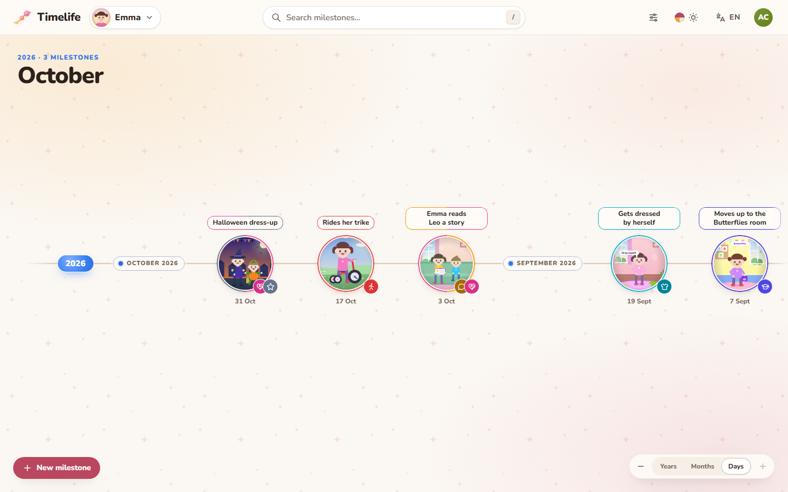
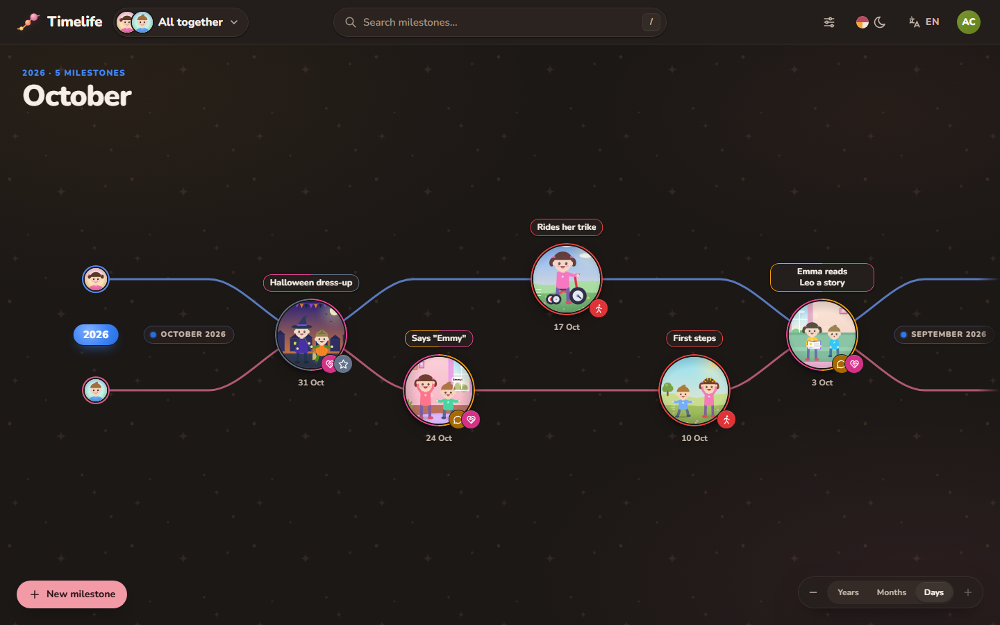
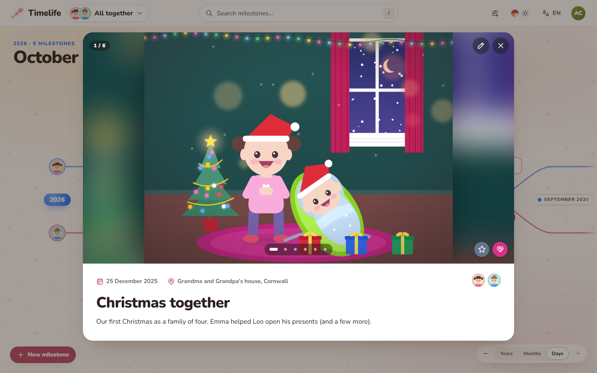
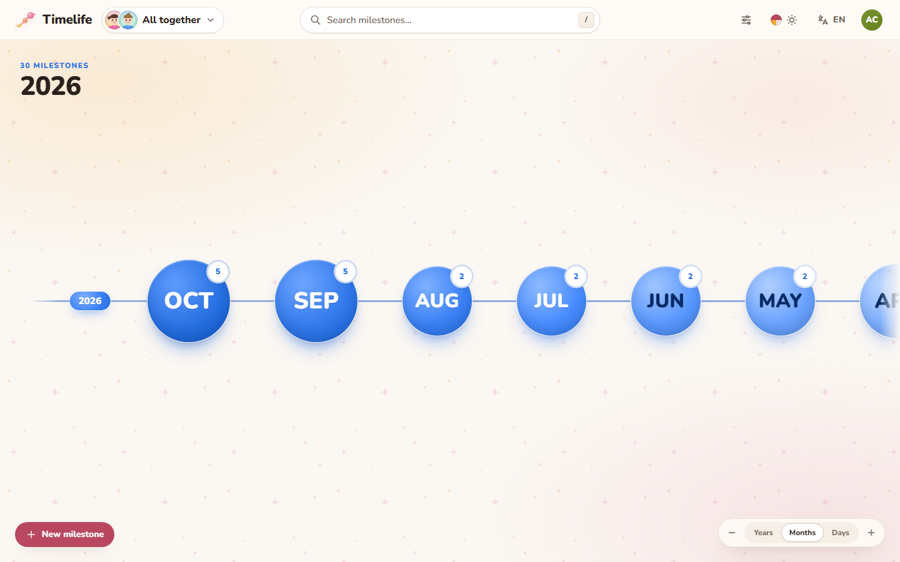
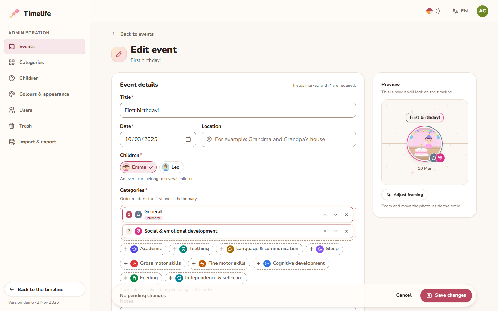
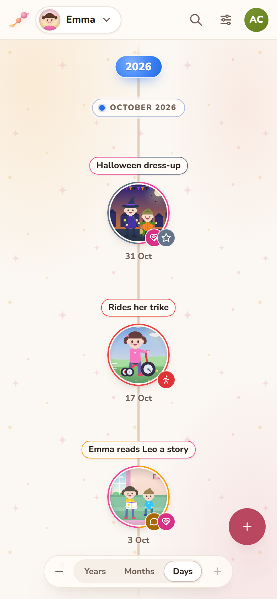
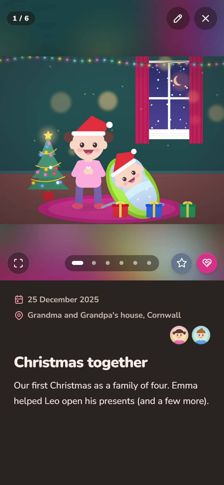
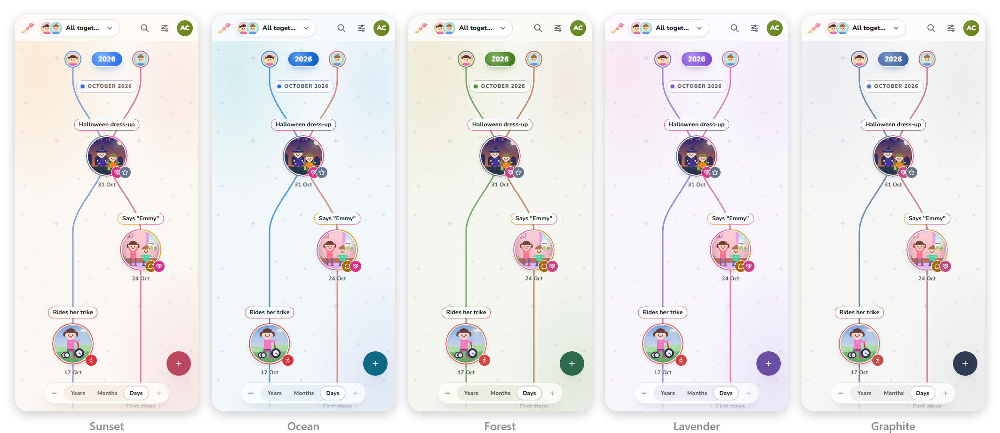

<div align="center">


# Timelife

**Your children's milestones on a private family timeline.**

Photos, videos and notes on a timeline you can zoom from years to days, shared only with the family and friends you
invite. Self-hosted with Docker.

[](https://github.com/DrDonoso/timelife/actions/workflows/docker-deploy.yml)
[](https://hub.docker.com/r/drdonoso/timelife)
[](LICENSE)

**[Live demo](https://demo.timelife.lauvid.com)** · [Features](#features) · [Deploy](#deploy-with-docker) ·
[Documentation](#documentation) · [Contributing](CONTRIBUTING.md)

</div>



> **En español:** Timelife es una aplicación web privada, solo por invitación, para guardar y revivir los hitos de cada
> hijo en una línea de tiempo interactiva con zoom (años → meses → días), con fotos, vídeos, notas y categorías. La
> interfaz está en español por defecto, y también en inglés y en portugués de Portugal; esta documentación está en
> inglés.

## Why Timelife

My partner and I built Timelife to follow the milestones of our children — the first smile, the first steps, the
first words, the first day at nursery — and to share them only with our family and friends, instead of posting them
on social networks.

That is why it is private by design: it runs on your own server, there is no public sign-up (an administrator gives
each person access), every photo and video needs a signed-in session, and uploads lose their metadata (location,
device). We are sharing the code in case it helps other families do the same.

## Live demo

**[demo.timelife.lauvid.com](https://demo.timelife.lauvid.com)** runs the whole app in your browser with a made-up
family: you are signed in as an administrator, so you can browse the timelines, add milestones with photos and videos
and try every administration page. Nothing is stored or sent anywhere — reload the page to start again
([how the demo works](docs/demo.md)).

## Features

- **A timeline per child**, plus *All together*: each child on their own coloured line, with the milestones they share
  in between. Horizontal on computers and vertical on phones, newest first.
- **Zoom from years to days** with the mouse wheel, a pinch, the keyboard or the zoom control; year and month hubs grow
  with the number of milestones they hold.
- **Milestones with photos, videos and notes**: categories, place and the children involved, in a card with a photo
  carousel, full-screen photos, playable videos and iPhone **Live Photos**.
- **Search and filters** by title, date range and category.
- **Administration** to add milestones (drag-and-drop uploads, cover framing, the order of a day's milestones),
  children, categories, colours, users and a trash bin.
- **Import and export**: one ZIP with everything, original photos included, to move to another server or keep a copy.
- **Spanish, English and Portuguese**, five colour themes with light and dark modes, and installable on a phone's home
  screen.
- **Private and secure**: invitation-only sign-in with e-mail and password (Google optional), no public pages, metadata
  removed from photos and videos, strict security headers and a non-root container.

Every detail is in [docs/features.md](docs/features.md).

## Screenshots

<table>
  <tr>
    <td width="50%"></td>
    <td width="50%"></td>
  </tr>
  <tr>
    <td align="center"><em>All together</em>, in dark mode</td>
    <td align="center">A milestone's card</td>
  </tr>
  <tr>
    <td width="50%"></td>
    <td width="50%"></td>
  </tr>
  <tr>
    <td align="center">Zoomed out to months</td>
    <td align="center">The milestone editor</td>
  </tr>
</table>

<p align="center">
  
  &nbsp;&nbsp;&nbsp;
  
</p>



## Deploy with Docker

Timelife ships as one image, [`drdonoso/timelife`](https://hub.docker.com/r/drdonoso/timelife) (the FastAPI backend
and the compiled React app), that runs next to PostgreSQL with Docker Compose. You need a Linux host with Docker
Engine and the Compose plugin, and a domain name with an HTTPS reverse proxy.

1. **Download the Compose file and the settings template:**

   ```sh
   mkdir -p /opt/timelife && cd /opt/timelife
   curl -fsSLO https://raw.githubusercontent.com/DrDonoso/timelife/main/docker-compose.yml
   curl -fsSL -o .env https://raw.githubusercontent.com/DrDonoso/timelife/main/.env.example
   chmod 600 .env
   ```

2. **Fill in `.env`**, at least these three settings (see [Configuration](#configuration)):

   ```dotenv
   POSTGRES_PASSWORD=<a random value>
   AUTH_SECRET=<another random value, at least 32 characters>
   PUBLIC_ORIGIN=https://timelife.example.com
   ```

   Generate each random value with
   `docker run --rm python:3.14-slim python -c "import secrets; print(secrets.token_urlsafe(48))"`.

3. **Start it:**

   ```sh
   docker compose pull
   docker compose up -d
   docker compose ps                          # app and db become "healthy"
   curl -fsS http://127.0.0.1:7779/health     # {"status":"ok"}
   ```

4. **Put it behind your HTTPS reverse proxy**, keeping the original `Host` header, and set `TRUSTED_PROXY_IPS` in
   `.env` to the proxy's address as seen from the container. With [Caddy](https://caddyserver.com/), for example:

   ```caddyfile
   timelife.example.com {
       reverse_proxy 127.0.0.1:7779
   }
   ```

5. **Open the site right away and create the administrator account**: a new installation offers it on its login page
   to whoever opens it first. Then add the children and give your family access from the administration (*Usuarios*,
   or *Users* in English).

**Updates:** back up first, then `docker compose pull && docker compose up -d`; database migrations run on their own.
Pin `IMAGE_TAG` in `.env` to a release (for example `20261102`) to update only when you choose.

Read the [deployment guide](docs/deployment.md) before trusting Timelife with your photos: it covers the reverse proxy
checklist (upload sizes, forwarded headers, Cloudflare), updates and rollbacks, and **backups and restore**.

## Configuration

Settings are environment variables read from `.env`; [`.env.example`](.env.example) documents each of them. The
essentials:

| Variable | Required | Description |
| --- | --- | --- |
| `POSTGRES_PASSWORD` | yes | Password of the bundled PostgreSQL database (URL-safe). |
| `AUTH_SECRET` | yes | Key that signs sessions: at least 32 random characters. |
| `PUBLIC_ORIGIN` | yes | The address(es) people open, e.g. `https://timelife.example.com` (comma-separated). |
| `TRUSTED_PROXY_IPS` | behind a proxy | Address of your reverse proxy as seen from the container (never `*`). |
| `GOOGLE_CLIENT_ID`, `GOOGLE_CLIENT_SECRET` | no | Adds *Continue with Google* ([setup](docs/configuration.md#google-sign-in-setup-optional)). |
| `SMTP_HOST`, `SMTP_FROM`, … | no | Lets people reset a forgotten password by e-mail ([setup](docs/configuration.md#e-mail-smtp-setup-optional)). |
| `MAX_UPLOAD_MB`, `MAX_VIDEO_UPLOAD_MB` | no | Size limits of one photo (30 MB) and one video (500 MB). |
| `TZ` | no | Time zone of the server (`Europe/Madrid`). |

After editing `.env`, recreate the container: `docker compose up -d --force-recreate app`. The full list is in
[docs/configuration.md](docs/configuration.md).

## Documentation

| Guide | What it covers |
| --- | --- |
| [Features](docs/features.md) | Everything Timelife does, in detail |
| [Deployment](docs/deployment.md) | Server setup, reverse proxy, updates, backups and restore |
| [Configuration](docs/configuration.md) | Every setting, Google sign-in and e-mail (SMTP) setup |
| [First run and family access](docs/administration.md) | The first administrator, giving people access, roles and lost passwords |
| [Troubleshooting](docs/troubleshooting.md) | Common problems and their fixes |
| [Architecture](docs/architecture.md) | How the pieces fit together, the technology and the repository layout |
| [Development](docs/development.md) | Running from source, tests, continuous integration and releases |
| [Public demo](docs/demo.md) | How the static demo works and how to deploy your own |

## Development

The local stack builds the image from your working copy and adds a development login:

```sh
cp .env.example .env    # then fill in POSTGRES_PASSWORD and AUTH_SECRET
docker compose -f docker-compose.local.yml up -d --build
docker compose -f docker-compose.local.yml exec app python -m timelife.demo   # optional sample data
```

Open <http://localhost:7779> and sign in as `admin` with the password `admin`. Hot reload without Docker, the test
suites and the release process are described in [docs/development.md](docs/development.md).

Timelife is built with Python, FastAPI, SQLAlchemy and PostgreSQL on the backend, and React, TypeScript and Vite on
the frontend.

## Contributing

Bug reports, fixes, translations and ideas are welcome: please read [CONTRIBUTING.md](CONTRIBUTING.md) and the
[Code of Conduct](CODE_OF_CONDUCT.md). Report security problems privately, as described in [SECURITY.md](SECURITY.md).

## License

Timelife is released under the [MIT License](LICENSE).
