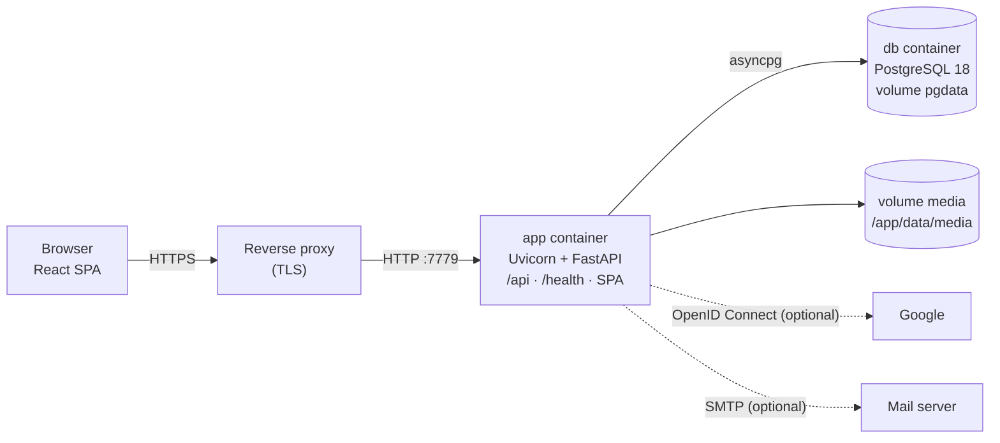

# Architecture



- **One image, one process.** `drdonoso/timelife` runs Uvicorn on port 7779 and serves the JSON API (`/api/...`),
  `/health` and the compiled React single-page app (`frontend/dist`) for every other route.
- **PostgreSQL 18** stores users, sessions, children, events, categories and settings. SQLite is supported for
  development and tests.
- **Media volume** (`/app/data/media`): one folder per photo with `original.<ext>`, `thumb.webp` (512×512) and
  `display.webp` (long edge ≤ 2048 px). A photo whose thumbnail framing was adjusted also gets `thumb-<key>.webp`,
  cropped from `display.webp` on its first request and removed when the framing changes; its URL carries the key
  (`/api/media/<id>/thumb?v=<key>`), so cached thumbnails never go stale. Videos also get `video.mp4` (their pictures
  show a poster frame), and Live Photos keep their clip as `motion.<ext>` plus its `video.mp4`
  (`/api/media/<id>/video`, served in byte ranges). Uploads are staged in `.incoming/` while they are identified; a
  backup being imported waits in `.imports/<id>/` (the file and its progress, so an upload survives restarts).
- **Import and export** (`/api/admin/backup/...`): the export is a ZIP written while it downloads (nothing is staged
  on disk; it starts at once). An import is uploaded in 32 MB pieces, checked, and run in the background in the app
  process: its photos and videos go through the upload pipeline (re-encoded, metadata removed; videos are converted
  again afterwards), then everything is written in one database transaction. One export or import runs at a time.
- **Video conversion** (FFmpeg, bundled in the image): the upload answers as soon as the files are stored and a
  background worker in the app process converts one video at a time, at a low CPU priority (status `processing` →
  `ready` or `failed`; conversions interrupted by a restart run again at startup). Run a single Uvicorn worker, as the
  container does. Videos that are already H.264 at most 1080p are only remuxed (seconds); others take roughly their own
  length or less on a modern CPU.
- **Sign-in**: e-mail and password always (salted scrypt hashes from Python's standard library, at most two computed
  at a time; a password stored with older parameters is rehashed at the next sign-in), plus **Google OpenID Connect**
  when configured: server-side authorization-code flow with PKCE, state and nonce, requesting only
  `openid email profile`; no Google tokens are stored. Sessions are random tokens in an HttpOnly cookie whose HMAC
  is stored. **SMTP** (optional) sends the "forgot password" links, after the request has been answered.
- **Startup** (`docker-entrypoint.sh`): `alembic upgrade head` → `python -m timelife.seed` (idempotent: default
  categories) → Uvicorn with proxy-header support. `/health` checks database access and drives the Docker
  healthcheck; `/api/version` reports the image version and build date.

## Technology

| Layer | Technology |
| --- | --- |
| Backend | Python 3.14, FastAPI, SQLAlchemy 2 (async), Alembic, Pydantic v2, asyncpg, Pillow + pillow-heif, FFmpeg, PyJWT |
| Frontend | React 19, TypeScript 7, Vite 8, React Router 8, TanStack Query, React Aria Components, Motion, Tabler Icons |
| Database | PostgreSQL 18 (SQLite for development and tests) |
| Packaging | uv 0.11.32, npm, multi-stage Docker build (`node:24-alpine` → `python:3.14-slim`), non-root user `app` (uid 1000) |

## Repository layout

```text
src/timelife/              FastAPI backend: settings, models, routers, media processing, backup import/export, seed and demo data
alembic/                   database migrations (run automatically when the container starts)
tests/                     backend tests (pytest)
scripts/export_openapi.py  exports the API contract to frontend/src/api/openapi.json
frontend/                  React + Vite single-page app (src/), its static public demo (src/demo/), Playwright tests (e2e/)
docs/                      these guides and the screenshots (docs/images/, made by `npm run gen:screenshots`)
Dockerfile, docker-entrypoint.sh, docker-compose.yml, docker-compose.local.yml, .github/workflows/
```
